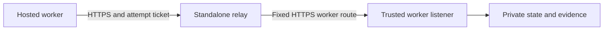

# Standalone private worker relay

## Purpose and current boundary

The teststudio-exchange command supplies a separate, credential-free frontend for the [private worker exchange](worker-exchange.md).
It forwards only the existing input, start, report, and attachment operations to one configured HTTPS worker backend.
It opens no database, artifact store, registry client, identity directory, or cloud SDK.
It does not execute uploaded tests.

This process supports the separate worker-facing service needed by Azure Container Apps.
The existing API worker listener still owns authentication, authorization, staging, durable state, and report validation.
The relay validates request scope and forwards the bounded worker credential. It does not authenticate that credential itself.

Azure service configuration, network admission, HTTPS binding, backend placement, and provider packaging remain unfinished.
This command alone enables no Azure coded execution.
The local demonstration and its stored data remain unchanged.



## Explicit startup configuration

Run the command behind trusted HTTPS ingress:

```sh
go run ./cmd/teststudio-exchange \
  --addr=127.0.0.1:8043 \
  --public-origin=https://workers.studio.example.test \
  --backend-origin=https://controller-workers.internal.example.test
```

| Option | Purpose |
| --- | --- |
| addr | Private HTTP listen address. The default is 127.0.0.1:8043. |
| public-origin | Exact worker-facing HTTPS origin. Worker requests must retain its Host value. |
| backend-origin | One fixed, trusted HTTPS worker-listener origin. An explicit TLS port is supported. |

Both origins are required. Paths, queries, credentials, fragments, invalid ports, and equivalent frontend/backend authorities reject startup.
The process reads no TestStudio credential environment variable or cloud identity configuration.
It supports no database, registry, secret, or user-session option.
Invalid options produce fixed errors without their values.

The HTTP listener requires trusted external HTTPS termination.
The backend must be the dedicated worker listener behind trusted TLS termination, rather than the normal UI, report, or user API origin.
The current --worker-addr listener itself uses HTTP. Its private TLS termination and restricted backend route still need provider packaging.
Do not point this relay at the ordinary application port and assume that network isolation exists.

Backend TLS uses normal certificate verification, a TLS 1.2 minimum, and the system trust store.
Environment proxy discovery is disabled. The backend hostname and port never come from a worker request.
The production client uses no insecure TLS override or redirect following.
Local tests can provide a transport with trust for their owned TLS servers.

## Worker request boundary

The relay accepts only these operations:

| Method | Path |
| --- | --- |
| GET | /internal/worker/v1/executions/EXECUTION/input |
| POST | /internal/worker/v1/executions/EXECUTION/started |
| PUT | /internal/worker/v1/executions/EXECUTION/report |
| PUT | /internal/worker/v1/executions/EXECUTION/attachments/FILE |

Execution and instance identifiers use the existing identifier grammar.
Attachment names remain single filename segments. Spaces remain supported through canonical escaping.
Encoded path aliases, traversal segments, extra operations, wrong methods, absolute request targets, and foreign Host values reject before forwarding.

A request needs one canonical 32-byte base64url Bearer ticket and one worker instance header.
Only Authorization and X-TestStudio-Worker-Instance carry caller authority to the backend.
The relay creates its own content type and user agent.
It forwards no browser cookie, project selector, identity header, client forwarding header, or arbitrary caller header.
Queries, browser Origin headers, upgrades, compressed bodies, duplicate credentials, and trailers reject inspection.
The controller still verifies the ticket, ownership, current authorization, activation, instance, and deadline.

Input requests cannot carry bodies.
Start messages have a 1 KiB limit.
The outer report envelope retains the shared 8 MiB plus 256 KiB discovery bound.
The controller retains its stricter 2 MiB plus 64 KiB ordinary test-report bound and complete report validation.
Attachment streams have a 64 MiB ceiling. The controller still checks the declared size, checksum, capture budget, and upload state.
Declared oversized bodies reject before backend access. Unknown-length bodies use a bounded streaming reader.
The relay does not buffer attachment uploads on disk or in a complete memory copy.

## Responses and availability

Input responses must decode as the shared packet with no unknown fields or trailing JSON.
The execution identifier must match the selected path, the deadline must remain future, and input JSON must fit the shared 4 MiB limit.
The relay emits the decoded packet without copying arbitrary backend response headers.
Writes require the existing 204 success response.

The relay preserves only the protocol's 400, 404, 409, and 507 error statuses.
Other responses, redirects, malformed input packets, oversized input, and transport failures become fixed 503 outcomes.
Backend bodies, cookies, redirect locations, and network diagnostics never become error details.
Responses use no-store and nosniff. Tickets never enter a URL or process access log.

At most eight requests forward concurrently. Saturation returns 503 without another backend request.
Each request has a 45-second context. Caller cancellation reaches the backend request.
The transport bounds connection count, dial time, TLS setup, response headers, and idle connection lifetime.
It adds no application-level retry or write replay.
Normal controller recovery and exact product retries remain responsible for uncertain outcomes.

GET /healthz and GET /livez return local process health without requiring the public Host.
They forward nothing and remain available during saturation.
These probes establish process availability only. They do not prove backend, database, storage, certificate, or network readiness.
Deployment admission must inspect and verify that separate path before enabling execution.

The command uses bounded HTTP headers and request timeouts.
SIGINT or SIGTERM starts graceful shutdown with a ten-second bound.
Shutdown closes the owned listener and idle backend connections.

## Packaging boundary

The staged deploy/worker-relay/Dockerfile uses scratch and user 65532:65532.
Its prepared context contains teststudio-exchange, teststudio-health, and a CA certificate bundle.
It contains no UI, API executable, preparation executable, database directory, or credential configuration.
Its health probe uses the existing health command on port 8043.

This delivery does not build or publish that image.
A reproducible image builder, immutable image approval, private registry access, provider service wiring, and deployed checks remain required.
Use the approved certificate source and architecture rules from the existing service packaging workflow when completing that builder.
Do not rebuild unrelated UI assets for the relay.

## Targeted local verification

Seven new focused race checks cover the existing client through local TLS, all four operations, bounded streaming, rejection, fixed authority, and command shutdown.
Two existing durable exchange checks pass after the wire aliases and identifier extraction.
A production dependency audit confirms standard-library packages plus identifier, workerwire, relay, and the command.
It links no storage, identity, secret, or cloud-SDK package.

```sh
go test -race ./adapters/workerexchange/relay ./cmd/teststudio-exchange -count=1
go test -race ./internal/workerexchange -run '^TestScopedWorkSurvivesControllerRestartAndHasOneWorkerInstance$|^TestFrozenReportsRequireCorrectBytesAndRemainRecoverableUntilCheckpoint$' -count=1
python3 scripts/verify-worker-relay-dependencies.py
```

All owned local HTTP and TLS listeners close through test cleanup. The command shutdown check confirms its port rejects new connections.
No cloud credential, live cloud API, deployment, registry push, UI build, browser, container, or image build runs.
Evidence is output/worker-relay/summary.json and the targeted command results.
Acceptance 51 advances. The count remains 48 verified items out of 57.

## Next implementation

Complete reproducible relay image packaging without a UI dependency.
Inspect Azure exchange environment approval, isolated application inventory, immutable relay image, argument configuration, and HTTPS certificate binding.
Verify that its backend reaches only the trusted worker listener and carries no installation credentials.
Complete effective DNS visibility, trusted preparation networking, cross-job isolation, execution placement, and role binding before native Azure enablement.
