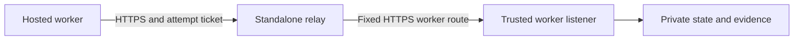

# Standalone private worker relay

## Purpose and current boundary

The teststudio-exchange command supplies a separate, credential-free frontend for the [private worker exchange](worker-exchange.md).
It forwards only the existing input, start, report, and attachment operations to one configured HTTPS worker backend.
It opens no database, artifact store, registry client, identity directory, or cloud SDK.
It does not execute uploaded tests.

This process supports the separate worker-facing service needed by Azure Container Apps.
The trusted worker listener owns authentication, authorization, staging, durable state, and report validation.
It can run in the API process or through the dedicated [worker backend role](worker-backend.md).
The relay validates request scope and forwards the bounded worker credential. It does not authenticate that credential itself.

The [selected Azure exchange inspector](azure-worker-exchange.md) now checks configured relay specification, approval, revisions, and HTTPS metadata.
Complete network admission, exclusive workload occupancy, backend placement, actual TLS verification, and provider service wiring remain unfinished.
This command alone enables no Azure coded execution.
The local demonstration and its stored data remain unchanged.



## Explicit startup configuration

Run the command behind trusted HTTPS ingress:

```sh
go run ./cmd/teststudio-exchange \
  --addr=127.0.0.1:8043 \
  --public-origin=https://workers.studio.example.test \
  --backend-origin=https://controller-workers.internal.example.test
```

| Option | Purpose |
| --- | --- |
| addr | Private HTTP listen address. The default is 127.0.0.1:8043. |
| public-origin | Exact worker-facing HTTPS origin. Worker requests must retain its Host value. |
| backend-origin | One fixed, trusted HTTPS worker-listener origin. An explicit TLS port is supported. |
| backend-address | Optional canonical private IPv4 address for both readiness and worker traffic. Normal HTTPS hostname verification remains required. |

Both origins are required. Paths, queries, credentials, fragments, invalid ports, and equivalent frontend/backend authorities reject startup.
The process reads no TestStudio credential environment variable or cloud identity configuration.
It supports no database, registry, secret, or user-session option.
Invalid options produce fixed errors without their values.

The HTTP listener requires trusted external HTTPS termination.
The backend must be the dedicated worker listener behind trusted TLS termination, rather than the normal UI, report, or user API origin.
The --worker-addr listener uses HTTP behind private TLS termination, or optional direct TLS in the dedicated worker role.
Both forms still need restricted backend routes and provider packaging.
The worker backend role provides a separate process without UI, sign-in, or background workers.
It holds installation storage access and stays on the trusted side of the relay boundary.
Its direct TLS mode validates mounted leaf identity before storage startup and requires the configured SNI and HTTP Host.
The relay continues normal chain verification. Native backend routing and installation admission remain separate work.
Do not point this relay at the ordinary application port and assume that network isolation exists.

Backend TLS uses normal certificate verification, a TLS 1.2 minimum, and the system trust store.
Environment proxy discovery is disabled. The backend hostname and port never come from a worker request.
The production client uses no insecure TLS override or redirect following.
Local tests can provide a transport with trust for their owned TLS servers.

## Worker request boundary

The relay accepts only these operations:

| Method | Path |
| --- | --- |
| GET | /internal/worker/v1/executions/EXECUTION/input |
| POST | /internal/worker/v1/executions/EXECUTION/started |
| PUT | /internal/worker/v1/executions/EXECUTION/report |
| PUT | /internal/worker/v1/executions/EXECUTION/attachments/FILE |

Execution and instance identifiers use the existing identifier grammar.
Attachment names remain single filename segments. Spaces remain supported through canonical escaping.
Encoded path aliases, traversal segments, extra operations, wrong methods, absolute request targets, and foreign Host values reject before forwarding.

A request needs one canonical 32-byte base64url Bearer ticket and one worker instance header.
Only Authorization and X-TestStudio-Worker-Instance carry caller authority to the backend.
The relay creates its own content type and user agent.
It forwards no browser cookie, project selector, identity header, client forwarding header, or arbitrary caller header.
Queries, browser Origin headers, upgrades, compressed bodies, duplicate credentials, and trailers reject inspection.
The controller still verifies the ticket, ownership, current authorization, activation, instance, and deadline.

Input requests cannot carry bodies.
Start messages have a 1 KiB limit.
The outer report envelope retains the shared 8 MiB plus 256 KiB discovery bound.
The controller retains its stricter 2 MiB plus 64 KiB ordinary test-report bound and complete report validation.
Attachment streams have a 64 MiB ceiling. The controller still checks the declared size, checksum, capture budget, and upload state.
Declared oversized bodies reject before backend access. Unknown-length bodies use a bounded streaming reader.
The relay does not buffer attachment uploads on disk or in a complete memory copy.

## Responses and availability

Input responses must decode as the shared packet with no unknown fields or trailing JSON.
The execution identifier must match the selected path, the deadline must remain future, and input JSON must fit the shared 4 MiB limit.
The relay emits the decoded packet without copying arbitrary backend response headers.
Writes require the existing 204 success response.

The relay preserves only the protocol's 400, 404, 409, and 507 error statuses.
Other responses, redirects, malformed input packets, oversized input, and transport failures become fixed 503 outcomes.
Backend bodies, cookies, redirect locations, and network diagnostics never become error details.
Responses use no-store and nosniff. Tickets never enter a URL or process access log.

At most eight requests forward concurrently. Saturation returns 503 without another backend request.
Each request has a 45-second context. Caller cancellation reaches the backend request.
The transport bounds connection count, dial time, TLS setup, response headers, and idle connection lifetime.
It adds no application-level retry or write replay.
Normal controller recovery and exact product retries remain responsible for uncertain outcomes.

GET /healthz and GET /livez return local process health without requiring the public Host.
They forward nothing and remain available during saturation.
These two probes establish process availability only.
GET /readyz now checks the dedicated worker backend over normally verified HTTPS without caller credentials.
It uses a separate bounded probe connection and requires the backend worker-role health reply.
Optional backend-address pins both worker traffic and readiness to one private address while retaining Host and TLS verification.
See [backend readiness and address binding](worker-relay-readiness.md) for limits, upgrade requirements, and Azure configuration.
Deployment admission must still inspect the installed route and effective network controls before enabling execution.

The command uses bounded HTTP headers and request timeouts.
SIGINT or SIGTERM starts graceful shutdown with a ten-second bound.
Shutdown closes the owned listener and idle backend connections.

## Packaging boundary

The deploy/worker-relay/Dockerfile uses scratch and user 65532:65532.
Its prepared context contains teststudio-exchange, teststudio-health, and a CA certificate bundle.
It contains no UI, API executable, preparation executable, database directory, or credential configuration.
Its health probe uses the existing health command on port 8043.

The new builder compiles only the relay and health binaries. It does not invoke UI, trace-viewer, preparation, or runner image builds.
It uses Linux, disabled CGO, readonly module inputs, trimmed paths, disabled VCS stamping, and explicit target architecture settings.
Both amd64 and arm64 are supported. Cross-architecture image builds require buildx.
The local verification in this delivery covers amd64 on the current ARM64 Docker host.

```sh
mkdir -p output/worker-relay-image
node scripts/build-worker-relay-image.mjs --arch=amd64 --local-only > output/worker-relay-image/build.json
python3 scripts/verify-worker-relay-image.py --build-result output/worker-relay-image/build.json --output output/worker-relay-image/runtime
```

If Docker cannot discover buildx, supply --buildx=/trusted/path/docker-buildx.
Omitting --arch selects the Docker host architecture.
The --local-only option requires a local Docker socket and forbids pulling a missing certificate-source image.
Without that option, the builder can fetch only the configured immutable certificate-source image when needed.
It never pushes the relay image.

The certificate source is the existing pinned deploy/service/certificate-source.json resource.
Only its public CA bundle enters the scratch image. No source-image executable or filesystem directory enters the package.
The private cache protects its files. The prepared image context makes the public certificate bundle readable by the non-root runtime.
The extraction container uses a unique owned name, never starts, and is removed with confirmed absence.
Build contexts disappear in finally cleanup.

The builder stores separate target caches under .data/worker-relay-build.
Selected Go source files, module metadata, compiler version, build arguments, and target settings determine binary reuse.
It verifies each cached binary's content hash before reuse.
The image identity binds binary hashes, certificate source and content, Dockerfile, builder scripts, and build backend version.
It verifies immutable image identity, architecture, source label, non-root user, entrypoint, environment, and absence of image-owned volumes.
Only Docker's standard PATH value can appear in its environment.
An unchanged invocation reuses both binaries, the certificate bundle, and the exact image.
It does not recompile, extract certificates, or perform an image build.

The local package check starts one owned container with no network, read-only root, no capabilities, and no writable mounts.
It runs the image's health and liveness probes and verifies bounded process configuration.
It inspects the exported filesystem without extracting application files.
Required artifact digests and readable or executable permissions must match the builder output.
Both executables must match the selected Linux architecture and require no dynamic interpreter.
Only the three regular package artifacts and known Docker runtime files are permitted.
The checker verifies graceful shutdown and confirms removal of its exact container.

Local packaging does not prove backend TLS reachability or complete Azure service authority.
Immutable registry publication, installed service image approval, private registry access, provider wiring, and separate deployment checks remain required.

## Targeted local verification

Seven new focused race checks cover the existing client through local TLS, all four operations, bounded streaming, rejection, fixed authority, and command shutdown.
Two existing durable exchange checks pass after the wire aliases and identifier extraction.
A production dependency audit confirms standard-library packages plus identifier, workerwire, relay, and the command.
It links no storage, identity, secret, or cloud-SDK package.

```sh
go test -race ./adapters/workerexchange/relay ./cmd/teststudio-exchange -count=1
go test -race ./internal/workerexchange -run '^TestScopedWorkSurvivesControllerRestartAndHasOneWorkerInstance$|^TestFrozenReportsRequireCorrectBytesAndRemainRecoverableUntilCheckpoint$' -count=1
python3 scripts/verify-worker-relay-dependencies.py
```

All owned local HTTP and TLS listeners close through test cleanup. The command shutdown check confirms its port rejects new connections.
The earlier relay workflow evidence is output/worker-relay/summary.json.
The packaging delivery adds one focused seven-check container workflow and one warm-cache reuse check.
Its evidence is output/worker-relay-image/build.json, cache-reuse.json, and runtime/summary.json.
Package verification accounts for Docker's default PATH and empty runtime device placeholders without allowing application configuration or extra payload files.
The certificate permission fix ensures that the non-root runtime can read its trusted public roots.
No Go runner fixture, broader Go suite, UI build, browser, cloud credential, live cloud API, registry push, or deployment runs.
Acceptance 51 advances. The count remains 48 verified items out of 57.

## Next implementation

Rebuild approved relay and backend images with the current address and readiness contract before the next private service configuration batch.
Compose the selected Azure exchange checks. Establish complete workload occupancy, effective networking, and trusted backend authority.
Verify that its backend reaches only the trusted worker listener and carries no installation credentials.
Complete effective DNS visibility, trusted preparation networking, cross-job isolation, execution placement, and role binding before native Azure enablement.
